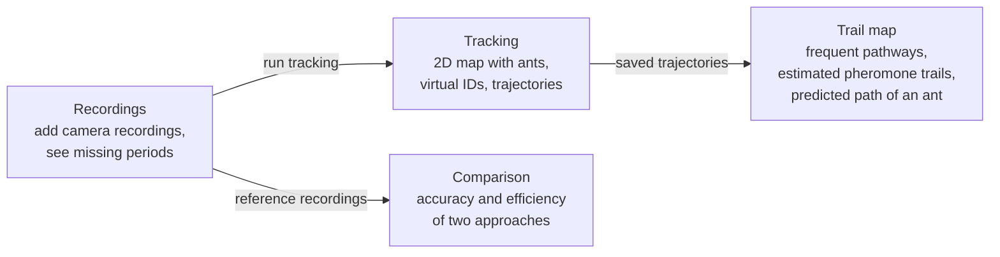

# Camera-Based Monitoring, Automatic Tracking, and Route-Behaviour Analysis of Ant Colony Individuals

## 1. Actors and permissions

| Role | Needs | Responsibility / access |
| --- | --- | --- |
| Researcher | Observe ant movement in the ant farm, find the frequently used pathways, estimate pheromone trails from the observed routes, and predict where an ant will go. | Adds camera recordings, runs tracking, reviews trajectories, the pheromone trail map, and path predictions, and compares approaches. |

The system has one user role.

## 2. Use cases / user stories

### Track ants and reconstruct trajectories

- **Actor:** Researcher
- **Precondition:** Recordings from the ant-farm cameras are available.
- **Main flow:**
  1. The actor adds the camera recordings of one observation session.
  2. The system combines the camera views into one 2D map of the ant farm.
  3. The system detects the ants, gives each ant a virtual ID, and tracks it over time.
  4. The system saves the trajectory of each ant as positions with timestamps.
  5. The actor reviews the trajectories on the map.
- **Alternative / error flows:** An unreadable recording is reported and skipped. If an ant is lost, for example behind another ant, its trajectory ends and the unseen part is not filled in. A period without recording is shown as missing data.
- **Postcondition:** The trajectories of the session are saved and can be reopened.

### Identify pathways and estimate pheromone trails

- **Actor:** Researcher
- **Precondition:** Saved trajectories exist for the selected session.
- **Main flow:**
  1. The actor selects a time interval.
  2. The system shows how often each area was traveled, in which direction, and how this changed over time.
  3. The system highlights the frequently used pathways.
  4. The system shows the estimated pheromone trail map: spatial distribution and relative intensity.
  5. The actor steps through time to see how the trails form and are reinforced.
  6. The actor selects one ant to compare its trajectory with the pathways and trails.
  7. The system predicts where the selected ant will go after the selected time, using only the pheromone trails estimated up to that time.
  8. The actor compares the prediction with the trajectory the ant actually followed.
- **Alternative / error flows:** Areas or periods that were not observed are shown as missing data, not as zero intensity. Where no trails are estimated yet, for example at the start of a session, no path is predicted.
- **Postcondition:** The pathway and pheromone trail maps are saved with their time interval.

### Compare alternative approaches

- **Actor:** Researcher
- **Precondition:** Two tracking approaches and manually checked reference recordings are available.
- **Main flow:**
  1. The actor selects reference recordings made under different observation conditions.
  2. The system runs both approaches on the same recordings.
  3. The system reports the tracking accuracy of each approach for each observation condition.
  4. The system reports the computational efficiency of each approach: processing time compared with recording duration.
  5. The actor decides which approach is more suitable for continuous observation.
- **Alternative / error flows:** If the two approaches were not run on the same recordings, no comparison is shown.
- **Postcondition:** The comparison is saved and the choice is supported by measured results.

## 3. Functional requirements

| Requirement                                                                 | Acceptance criteria                                                                                                                                                                                                                                                    | Priority |
| --------------------------------------------------------------------------- | ---------------------------------------------------------------------------------------------------------------------------------------------------------------------------------------------------------------------------------------------------------------------- | -------- |
| FR-01: Add multi-camera recordings.                                         | Given readable recordings from two or more cameras of the same session, when they are added, then each is listed with its camera and recording time. Unreadable files are reported, and periods without recording are shown as missing data.                           | Must     |
| FR-02: Combine the camera views into one 2D map.                            | Given recordings from two cameras of the same session, when they are combined, then positions from both cameras are shown on one 2D map of the ant farm, and an ant visible in both cameras at the same time appears once.                                             | Must     |
| FR-03: Detect ants.                                                         | Given a frame with several visible ants, when the frame is analyzed, then the position of each visible ant is marked.                                                                                                                                                  | Must     |
| FR-04: Identify individual ants.                                            | Given several ants detected in a frame, when identities are assigned, then each ant has its own virtual ID and no two ants in the same frame share an ID.                                                                                                              | Must     |
| FR-05: Track ants and reconstruct trajectories.                             | Given an identified ant that stays visible, when the following frames are analyzed, then the ant keeps its ID and its positions are saved with timestamps as one trajectory that is shown on the 2D map. If the ant is lost, the trajectory ends.                      | Must     |
| FR-06: Analyze movement and identify frequently used pathways.              | Given saved trajectories and a selected time interval, when the analysis is run, then the map shows how often each area was traveled (movement frequency), the direction of travel, and how usage changed over time, and the frequently used pathways are highlighted. | Must     |
| FR-07: Estimate pheromone trails.                                           | Given saved trajectories and a selected time interval, when the estimation is run, then a map shows the spatial distribution and relative intensity of the estimated trails. The map is labeled as an estimate, and unobserved areas are shown as missing data.        | Must     |
| FR-08: Show trail formation over time.                                      | Given the results of a session, when the researcher steps through time, then the pathway and pheromone trail maps show the state at the selected time, so trail formation and reinforcement can be followed.                                                           | Must     |
| FR-09: Relate individual movement to collective pathways.                   | Given a selected ant, when it is opened, then its trajectory is drawn over the pathway and pheromone trail maps.                                                                                                                                                       | Must     |
| FR-10: Predict the path of an ant. | Given a selected ant and a selected time, when a prediction is requested, then the path the ant is expected to take after that time is drawn on the map, marked as a prediction, next to the trajectory the ant actually followed. The prediction uses only the pheromone trails estimated up to that time. Where no trails are estimated yet, no path is predicted. | Must |
| FR-11: Measure tracking reliability under different observation conditions. | Given manually checked reference recordings, each labeled with its observation condition, when they are evaluated, then tracking accuracy (missed and false detections, identity switches, and broken trajectories) is reported for each condition.                    | Must     |
| FR-12: Compare two alternative approaches.                                  | Given two approaches run on the same reference recordings and the same computer, when the comparison is opened, then their tracking accuracy and computational efficiency (processing time and recording duration) are shown side by side.                             | Must     |
| FR-13: Save results.                                                        | Given completed results, when the application is reopened, then the trajectories, maps, and comparison are still available.                                                                                                                                            | Must     |

Priority: **Must** = required for the final product; **Should** = important; **Could** = optional if time permits.

ID's are added to the specification in order to make it easier to reference them later in the process.

## 4. Business rules and constraints

| Rule or constraint | Rationale |
| --- | --- |
| Only real ants in a controlled ant farm are observed. No simulated ants are used. | The project studies real colony behavior. |
| The pheromone trail map is an estimate derived from the observed routes. It shows relative intensity and is always labeled as an estimate. | It is an indirect representation of chemical signaling activity, not a measurement of pheromone concentration. |
| Before each observation session, the surface the ants walk on is cleaned with 70% ethanol. Each session is assumed to start with no pheromone trails, so the estimate starts at zero. | Removes existing pheromone trails as far as possible, so every session starts from the same state. |
| Multiple cameras observe the same ant farm in 2D. An ant seen by more than one camera at the same time is counted once. | Counting the same ant twice would falsely strengthen a trail. |
| An ant keeps its virtual ID until it is lost; then its trajectory ends and the unseen part is not filled in. | Invented paths would distort the pathways and the pheromone estimate. |
| A predicted path is always marked as a prediction. It is never saved as a trajectory and never used in the pheromone estimate. | Keeps prediction separate from observation. A predicted path counted as a route would strengthen the trail it was predicted from. |
| Periods or areas that were not observed are missing data, not zero activity or zero pheromone. Trajectories are not joined across a gap. | Missing data does not mean that no ants moved. |
| Tracking accuracy is measured against manually checked reference recordings. | Accuracy needs an independent reference. |
| Approaches are compared on the same recordings, the same reference data, and the same computer. | Makes the accuracy and efficiency results comparable. |

## 5. User interface and workflow

The application has four views. In **Recordings**, the researcher adds the camera recordings of a session. In **Tracking**, the detected ants, their virtual IDs, and their trajectories are shown on a 2D map of the ant farm. In **Trail map**, the frequently used pathways and the estimated pheromone trail intensity are shown for a selected time interval, and a time slider shows how the trails form. The predicted path of a selected ant is drawn on the same map. In **Comparison**, the tracking accuracy of the two approaches for each observation condition and their computational efficiency are shown side by side.

## 6. Non-functional requirements

| Requirement | How it will be verified |
| --- | --- |
| Results are easy to read: virtual IDs, direction, intensity scale, and time interval are labeled, and the pheromone map is marked as an estimate. | A person who did not build the system explains a saved map correctly. |
| Repeating the analysis on the same recordings with the same settings gives the same results. | Run the analysis twice and compare the outputs. |
| Computational efficiency is measured on documented hardware. | Record the recording duration and the wall-clock processing time of each approach. |
| A failed import or an interrupted run does not damage recordings or saved results. | Add an unreadable file and stop a run; confirm that earlier results still open. |

## 7. Open questions and risks

| Question / risk                                                                                         | Impact                                                              | Owner   | Resolution / decision                                                                                                    |
| ------------------------------------------------------------------------------------------------------- | ------------------------------------------------------------------- | ------- | ------------------------------------------------------------------------------------------------------------------------ |
| How are observed routes turned into relative pheromone intensity, and should older passages count less? | The estimate depends on this rule and cannot be checked chemically. | Student | The rule will be defined in the technical specification.                                                                 |
| How is the path of an ant predicted from the estimated trails, and how far ahead?                       | Decides how useful the prediction is and how it is checked.         | Student | The method will be defined in the technical specification.                                                               |
| Does cleaning with 70% ethanol remove the existing trails, and does it disturb the ants?                | The zero-pheromone start of each session depends on it.             | Student | Clean with the ants off the surface and let it dry before recording. Confirm the cleaning procedure with the supervisor. |
| Ants cross, cluster, and hide. Can individual identity be kept reliably?                                | Identity errors create wrong trajectories.                          | Student | End uncertain trajectories instead of guessing; measure identity switches against reference recordings.                  |
| Which observation conditions are compared?                                                              | Decides what the reliability results cover.                         | Student | Candidates: lighting, background, ant density, and occlusion. Agree on the list with the supervisor before recording.    |
| How many cameras are needed and where are they placed?                                                  | Poor placement lowers detail or leaves unobserved areas.            | Student | Test on pilot recordings; decide in the technical specification.                                                         |
| Which two approaches are compared?                                                                      | Their accuracy and efficiency may differ.                           | Student | Select in the technical specification.                                                                                   |
| Is continuous (live) observation practical?                                                             | Processing must keep up with recording.                             | Student | Decide from the measured processing time. Analysis of recorded video is the baseline.                                    |
| How much manually checked reference data is needed?                                                     | Too little data weakens the accuracy results.                       | Student | Decide on it after pilot recordings and discussing with the supervisor.                                                  |

## 8. Initial technical specification proposal

### Proposed solution

### Technology direction

| Area | Candidate technology / approach | Reason for consideration | Open question / risk |
| --- | --- | --- | --- |
| | | | |

### Initial architecture sketch

### Feasibility and technical risks

| Risk / assumption | Validation planned for semester 2 | Fallback approach |
| --- | --- | --- |
| | | |
