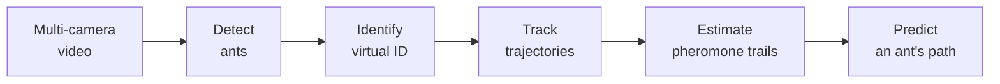
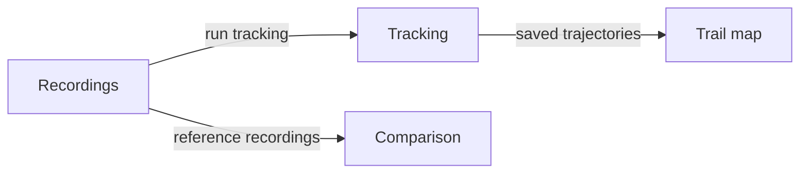

<!-- @slide Title -->

<!-- 5xl -->
# Camera-Based Monitoring, Automatic Tracking, and Route-Behaviour Analysis of Ant Colony Individuals

Author: Yusuf Atakan AKYUZ  
Neptun: OKG649  
Supervisor: Tamás STORCZ  
Project ID: 2026-ST-04

---

<!-- @slide Problem -->

## Problem

<!-- @set-align left -->
<!-- @set-width 70% -->

- Ants mark the routes they use often with **pheromone**. This is central to how a colony coordinates its movement without a leader.
- Pheromone trails **cannot be seen** in a video.
- Ant **movement** can be seen.

<!-- @callout question -->
> Can we track ants in an ant farm and estimate the pheromone trails from their routes?

---

<!-- @slide Project idea -->

### From video to trails

The estimate is **indirect**: it comes from movement, not from a chemical measurement.

<!-- @note -->
> **Virtual ID:** a number the software gives an ant so it can be followed from frame to frame. Nothing is put on the ant. If the ant is lost, its trajectory ends; when it reappears it gets a new ID.

---

<!-- @slide Target users -->

## Target users

<!-- @set-align left -->
<!-- @set-width 70% -->

**Researchers** who study ant behavior and swarm intelligence. The system has one role: the **Researcher**.

The researcher wants to:

- see where each ant went
- find the frequently used pathways
- see the estimated pheromone trails and how they form
- compare a predicted path with the trajectory the ant actually followed
- know how reliable the tracking is

---

<!-- @slide Planned scope -->

## Planned scope

<!-- @set-align left -->
<!-- @columns 2 4 -->

### In scope

- Real ants, ant farm, several cameras
- Track each ant, save its trajectory
- Frequently used pathways
- Estimated pheromone trail map
- How trails form and are reinforced
- Path prediction for one ant
- Tracking reliability
- Comparison of two tracking approaches

<!-- @col-break -->

### Out of scope

- Chemical measurement of pheromone
- Simulated ants
- 3D reconstruction
- Physical marking of ants
- Building a swarm-intelligence model

<!-- @columns -->

---

<!-- @slide Rules -->

### Rules behind the results

<!-- @set-align left -->
<!-- @set-width 70% -->

- Before each session the surface is cleaned with **70% ethanol**. We assume no trails are left, so the estimate starts at **zero**.
- Not observed means **missing data**, not zero.
- When an ant is lost, its trajectory **ends**. Nothing is filled in.
- A **prediction** is never saved as a trajectory and never used in the estimate.
- An ant seen by two cameras at the same time is counted **once**.

<!-- @note -->
> **Ethanol:** the zero start is an assumption. Open question: does it remove every trail, and does it disturb the ants? Clean with the ants off the surface and let it dry.

---

<!-- @slide User journeys -->

## Initial user journeys

Four screens, three journeys.

---

<!-- @slide Journey 1 -->

### Journey 1: Track the ants

<!-- @set-align left -->
<!-- @set-width 70% -->

1. Add the camera recordings of one session.
2. The system joins the camera views into one 2D map.
3. It detects the ants, gives each a virtual ID, and tracks it.
4. Each trajectory is saved as positions with timestamps.
5. The researcher reviews the trajectories on the map.

---

<!-- @slide Journey 2 -->

### Journey 2: Pathways, trails, and prediction

<!-- @set-align left -->
<!-- @set-width 70% -->

1. Select a time interval.
2. See how often and in which direction each area was traveled.
3. See the frequently used pathways and the estimated pheromone trail map.
4. Step through time and watch the trails form.
5. Select an ant: its predicted path is drawn next to its real trajectory.

<!-- @note -->
> **Prediction:** uses only the trails estimated up to the selected time. At the start of a session there are no trails yet, so no path is predicted.

---

<!-- @slide Journey 3 -->

### Journey 3: Compare two tracking approaches

<!-- @set-align left -->
<!-- @set-width 70% -->

1. Select manually checked reference recordings made under different observation conditions.
2. The system runs both approaches on the same recordings.
3. It reports tracking accuracy for each condition.
4. It reports processing time compared with recording duration.
5. The researcher decides which approach suits continuous observation.

<!-- @note -->
> **Reference recordings:** checked by hand, so accuracy has an independent reference. **Conditions:** candidates are lighting, background, ant density, occlusion. **Accuracy:** missed and false detections, identity switches, broken trajectories. **Continuous:** live observation; recorded video is the baseline.

---

<!-- @slide Next steps -->

## Next steps

<!-- @set-align left -->
<!-- @set-width 70% -->

- Agree in the technical specification: which observation conditions, how many cameras, and where.
- Pilot recordings: test the camera placement and the ethanol cleaning.
- Technical specification: the two approaches, the pheromone estimation rule, and the prediction method.
